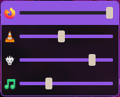

# PipeRat

Tired of going through windows to change their volume? This is for you.  

PipeRat takes all of your PipeWire audio streams, puts them in a convenient list and let's you change their volume
without affecting your global settings. All from the comfort of your own keyboard!  

<p align="center">
    
</p>

I hate how unreliable SwayNC's per-app mixer is, so I built this trash!!!

## Requirements

Build dependencies:
- GCC
- GNU Make
- pkg-config

Runtime dependencies:
- A Wayland compositor with layer shell support like Sway or Hyprland
- GTK 4
- GTK 4 Layer Shell
- PipeWire
- RobotoMono Nerd Font (**optional:** default font used in the style settings)

The font settings can be changed in the [style file](examples/style.css#L8).

## Installation

```bash
# Clone the repository and compile
git clone https://github.com/torisaurus2003/piperat.git
cd piperat
make

# Create the user configuration folder
mkdir -p ~/.config/piperat/

# Copy the configuration files to the user directory
cp ./examples/config ~/.config/piperat/
cp ./examples/style.css ~/.config/piperat/

# Run the executable
./piperat
```
The program comes with its own built-in configuration and overrides it with any user configuration found in
```~/.config/piperat/config```. Without ```~/.config/piperat/style.css``` the program will use the global GTK theme.
Custom paths for the configuration and style paths can be set through the command line using:

```bash
./piperat -c /path/to/config/file/
./piperat -s /path/to/style/file/
```

## Configuration Options
- **width=*int***  
Sets the window's width in pixels. Default is 170
- **height=*int***  
Sets the window's height in pixels. Default is 1
- **spacing=*int***  
Sets the spacing between the icon and the slider. Default is 0
- **title=*str***  
Sets the window title. Default is "piperat"
- **set_as_layer=*bool***  
Sets the window's layer shell protocol. Default is true
- **namespace=*str***  
Sets the window's namespace (requires set_as_layer=true). Default is "piperat"
- **x_pos=*int***  
Sets the window's horizontal position in pixels (requires set_as_layer=true). Default is unset
- **y_pos=*int***  
Sets the window's vertical position in pixels (requires set_as_layer=true). Default is unset.
If both x_pos and y_pos are unset, the window defaults to the center. The position increases from left to right and top to bottom
- **volume_step=*double***  
Sets the slider step size. Default is 0.05
- **set_tooltip=*bool***  
Sets the tooltip for the streams. The tooltip contains the stream's ID, application and name

## Styling configuration

The following classes can be configured inside "style.css":

- **.window**: the window itself
- **.listbox**: the listbox containing the rows
- **.row**: the row containing the icon and slider
- **.icon**: the stream icon
- **.slider**: the volume slider

If using nerd fonts, it's recommended to configure the icons like this:

```css
.window {
	font-family: Symbols Nerd Font Mono, RobotoMono Nerd Font Mono;
}
```
which makes it so the Symbols font overrides the icons in the main font, preventing possible size mismatches.
